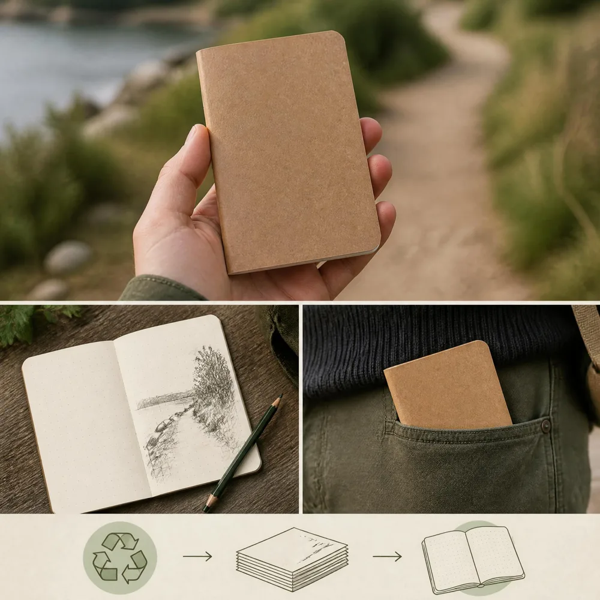

# Two runnable MCP workflows / 两个完整工作流

Use Node.js 22+. Clone this repository, then:

```bash
npm ci
npm run build
node examples/workflows.mjs campaign
node examples/workflows.mjs image
```

Without `--live`, both commands are **offline simulations**, producing labeled sample copy and a 1-pixel PNG. They do not prove model quality or client compatibility. Outputs go to unique `results/offline-demo-*` directories; existing results are not overwritten.

## Workflow 1: product brief → copy → image

Input: [product-brief.txt](product-brief.txt), a small public example describing a notebook. The client calls list_models, checks exact IDs/endpoints, asks chat for a headline and three fact-based bullets, then calls generate_image once. The illustration uses the product facts; it is not image editing or a promise of accurate typography.

Set `CRAZYROUTER_API_KEY` in the local shell and explicitly run:

```bash
node examples/workflows.mjs campaign --live
```

This performs one text and one image generation, which may incur normal API charges. Expected files: `copy.md`, `image.png` (or .jpg/.webp), `report.json`, `mode.txt` in a new results/live-campaign-* directory. Review the copy against the supplied facts before publishing it. The workflow itself publishes nothing.

## Workflow 2: discover → generate → save an image

```bash
node examples/workflows.mjs image --live
```

This omits chat and generates one image. It handles inline base64 and HTTPS download links, checks HTTP errors and file signatures, and refuses overwriting files. Downloads do not receive your API key. Files over 25 MiB and redirected download URLs are refused; inspect an unexpected hosting format before extending that behavior.

## Failure recovery

Completed steps are saved to failure.json if a later step fails. No automatic retries occur. A failed download may follow a successful, billable generation; inspect the account record before rerunning. Signed image URLs and raw tool errors are not written to the report. Normal report.json stores tool timings and artifact size, **not actual spend**: MCP 1.0.1 omits API usage and billed amounts.

For cost analysis, use the [normalized ledger calculator](https://github.com/xujfcn/claude-code-pricing-guide/blob/main/docs/ledger.md) and your actual account records. Do not infer cost from execution time.

中文：先运行默认离线演示确认文件流程，再显式添加 --live。campaign 生成文案和一张配图，image 只生图；两者均先检查模型可见性和端点。实际调用收费，发生失败不自动重试，不自动上传或发布产物。

## Client verification table

| Client / path | Configuration | Verified scope |
|---|---|---|
| Included Node stdio client | Local built dist/index.js | See [validation record](../evidence/validation.json); independent of GUI clients |
| Claude Desktop | README mcpServers example | Configuration example; GUI rendering and full workflow not verified in this release |
| Cursor | .cursor/mcp.json | Configuration example; GUI rendering and full workflow not verified in this release |
| VS Code | .vscode/mcp.json servers schema | Configuration example; GUI rendering and full workflow not verified in this release |

If tools do not appear, check Node version, executable resolution and the client configuration schema. If the server starts but discovery fails, check the key. If images do not render, use the file-saving workflow. Server diagnostics must stay on stderr because stdout carries MCP messages.

## A real output from the included fixture

The local stdio workflow completed on 2026-10-12. [Generated copy](output-copy.md) · [Human review of unsupported claims](review.md) · [Redacted test record](../evidence/validation.json). The image below is a resized preview, not the original API asset. This single sample is not a quality or price guarantee.


